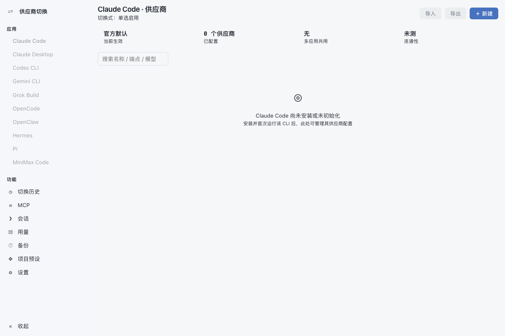

# 供应商切换

AI CLI 供应商切换台：10 应用配置管理、50+ 预设、MCP 同步、会话浏览与用量统计（复刻 cc-switch）

## 功能

- AI CLI 供应商切换台
- MCP 服务器管理
- AI 会话浏览与用量
- 切换台设置

## 使用方式

在 eNest 中打开插件，或使用快捷启动搜索功能名称。主窗口适合连续操作，Quick 适合完成一次任务；可在两种模式之间切换。

## 界面预览

截图使用隔离演示数据，不连接用户的真实账户、服务器或文件。
