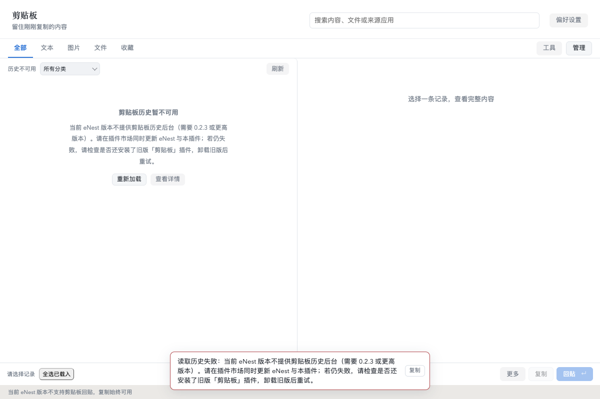

# 剪贴板

搜索文本、图片与文件历史；快捷回贴，桌面预览与批量整理。

## 功能

- 剪贴板历史
- 管理剪贴板历史

## 使用方式

在 eNest 中打开插件，或使用快捷启动搜索功能名称。主窗口适合连续操作，Quick 适合完成一次任务；可在两种模式之间切换。

## 1.4.0 升级说明

- 要求 eNest 0.0.1 及以上；旧宿主没有通用后台页面能力，不能继续使用旧的宿主剪贴板历史接口。
- 历史模型、查询、去重、收藏、保留策略、持久化和 Quick 搜索现在全部由本插件的沙箱后台页面实现；不增加 `backend.node` 权限或 Node 常驻进程。
- 持续采集仍要求“授权并记住”剪贴板历史权限。只允许本次运行不会启动持续采集；关闭插件界面不会取消已授权采集，关闭监控、禁用、卸载或撤权会停止。后台按事件唤醒，完成写入后返回，空闲由宿主回收。
- 旧历史在首次使用时逐个迁移到插件私有存储，保留历史 ID、收藏、来源、分类关联及图片。只有完整写入成功才标记完成；原始 JSON、备份及图片均保留。损坏、缺失图片、越界或超过安全传输上限时明确报错，不静默删除旧数据。较大历史首次读取可能需要等待。
- 文件历史中的路径不等于文件访问授权。未授权的路径显示“尚未授权检查”，定位操作会经宿主原生对话框确认目标；不会为了显示文件状态静默读取任意路径。

来源排除与来源记录是独立设置：关闭“记录来源”后，排除应用规则仍生效，但被保留记录不保存来源信息。

## 界面预览

截图使用隔离演示数据，不连接用户的真实账户、服务器或文件。
