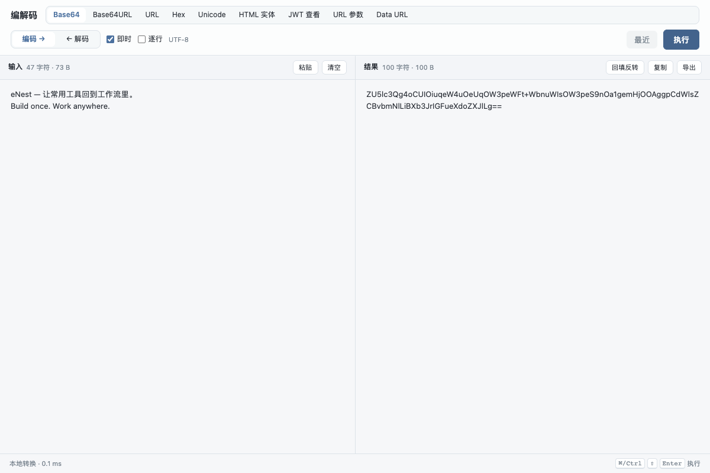

# 编解码

Base64、URL、Hex、Unicode、HTML 编解码与 JWT、URL 参数查看。

## 功能

- 编解码
- 离线查看 JWT
- URL 参数解析

## 使用方式

在 eNest 中打开插件，或使用快捷启动搜索功能名称。主窗口适合连续操作，Quick 适合完成一次任务；可在两种模式之间切换。

## 界面预览

截图使用隔离演示数据，不连接用户的真实账户、服务器或文件。
