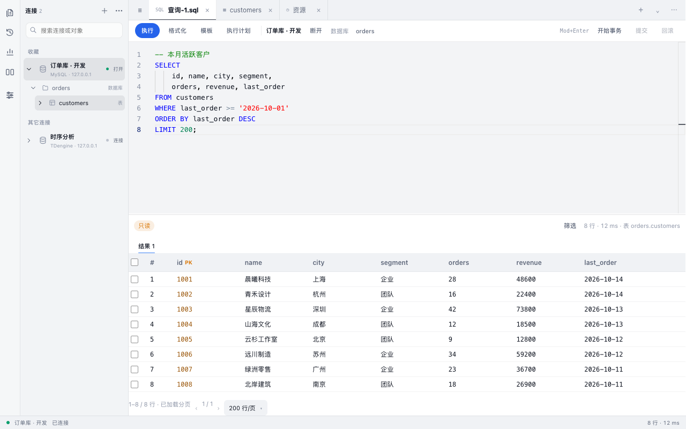

# 数据库

连接和对象常驻左侧，查询、表数据、结构与管理任务在右侧多标签中连续处理。

## 功能

- 左侧连接面板支持搜索、收藏、环境分组与按需加载的数据库、Schema 和对象树。
- 左侧窄图标栏提供文档、历史、资源、比较和设置入口，悬停或键盘聚焦显示名称。
- 查询与对象统一为工作标签，支持重排、关闭和恢复；对象标签内切换数据、字段、索引与外键结构。
- 查询文档、历史、资源中心、只读数据与结构比较，以及设置都有独立工作标签。
- 查询编辑、补全、执行计划、事务、可编辑结果、服务器分页、筛选、导入导出与表设计按驱动能力提供。
- SQL 支持全文／选区格式化、自动缩进、行注释、查找替换和保留撤销历史。设置中的快捷键列表可搜索、录制组合键、检查冲突与恢复默认。
- 数据表头并列显示字段名与备注，过长截断，悬停查看完整名称、备注和类型。列菜单提供复制字段名、排序、筛选和批量修改。
- 选中多行可批量赋值、设置 NULL、复制为新行或标记删除；TSV / Excel 粘贴先验证整个区域，再写入本地缓冲，支持撤销、重做与选中行还原。
- 提交前展示增删改数量与 SQL。支持事务的驱动使用整批事务；手动事务中写入后仍需提交，失败保留修改。新增行写入后等待刷新读取生成主键，不能重复提交。
- 导出可选择已加载筛选结果、当前页或选中行，以及需要的字段。支持 CSV、TSV、JSON、SQL INSERT 和 Markdown；可配置文件名、CSV 分隔符、表头、BOM 及 SQL 事务。
- MySQL / MariaDB 对象树分别展示表、视图、存储过程、函数、触发器和事件。详情按需读取参数、属性和原始定义；调用模板为注释草稿，视图数据按只读方式浏览。
- Quick 使用连接抽屉和独立只读会话，每次最多读取 200 行；可展开结果、翻页、筛选，并转到桌面继续。
- 连接面板宽度、布局和标签会恢复；重新打开不会自动连接数据库、恢复事务或执行查询。

## 使用方式

在 eNest 中打开数据库，使用左侧“＋”添加连接，再展开连接查看对象，或打开查询文档。双击对象或按 Enter 打开数据，在对象标签内查看结构。窗口较窄或使用 Quick 时，点左上角连接按钮展开面板；“桌面继续”保留当前文档与结果。

执行和连接上下文位于标签下方。窄窗口通过“更多”访问格式化、模板、执行计划和事务操作；查询文档关闭后仍可从左侧图标栏“查询文档”重新打开。

默认 `Mod+Enter` 在编辑器执行查询，在结果表格预览并提交本地修改；`Mod+Shift+F` 格式化全文，`Mod+Alt+Shift+F` 格式化选区，`Mod+/` 切换行注释。`Mod` 在 macOS 为 Command，在 Windows / Linux 为 Ctrl。方向键在表格中移动，F2 / Enter 编辑，Shift+空格选择行，Mod+Z 撤销本地修改。普通表单和单元格输入保留原生按键。

导出包含选定范围内的本地修改，排除标记删除的行，不会隐式写入数据库或读取服务器其它页。存储过程等元数据使用独立只读连接；权限不足或驱动尚未支持时显示原因。

## 数据与权限

本插件申请的敏感权限：`db.connect`、`db.query`、`db.schema`、`notify`、`clipboard.write`、`shell.openExternal`。使用相应系统、网络或用户数据能力时，eNest 检查清单并请求用户授权；你可以在插件设置中改为允许、询问或拒绝。

插件自身的数据与密钥存储、壳内界面、插件设置、主题和声明式功能入口属于 eNest 的基础能力，直接可用，无需在清单中声明或单独授权。插件仍在隔离环境运行，不能直接访问 Node 或操作系统；读取、写入用户文件须经过宿主的文件选择与句柄 API。

## 界面预览

截图使用隔离演示数据，不连接用户的真实账户、服务器或文件。
