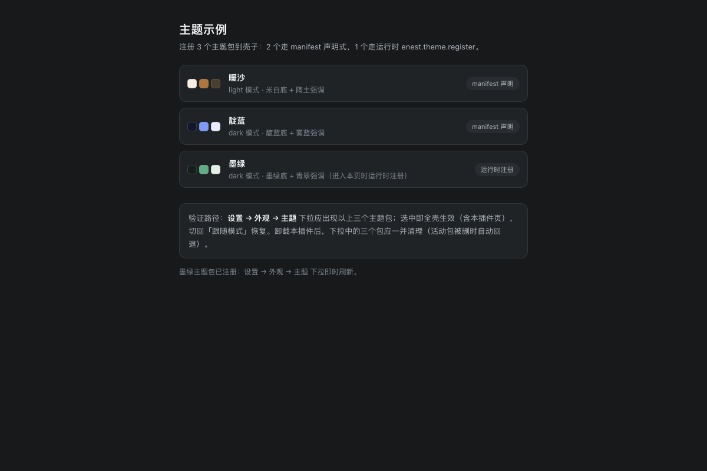

# 主题示例

主题包注册示例：manifest 声明「暖沙 / 靛蓝」双模式主题包，运行时注册「墨绿」，到设置→外观→主题下拉验证切换。

## 功能

- 主题包注册示例

## 使用方式

在 eNest 中打开插件，或使用快捷启动搜索功能名称。主窗口适合连续操作，Quick 适合完成一次任务；可在两种模式之间切换。

## 数据与权限

本插件不申请系统或隐私权限。

插件自身的数据与密钥存储、壳内界面、插件设置、主题和声明式功能入口属于 eNest 的基础能力，直接可用，无需在清单中声明或单独授权。插件仍在隔离环境运行，不能直接访问 Node 或操作系统；读取、写入用户文件须经过宿主的文件选择与句柄 API。

## 界面预览

截图使用隔离演示数据，不连接用户的真实账户、服务器或文件。
