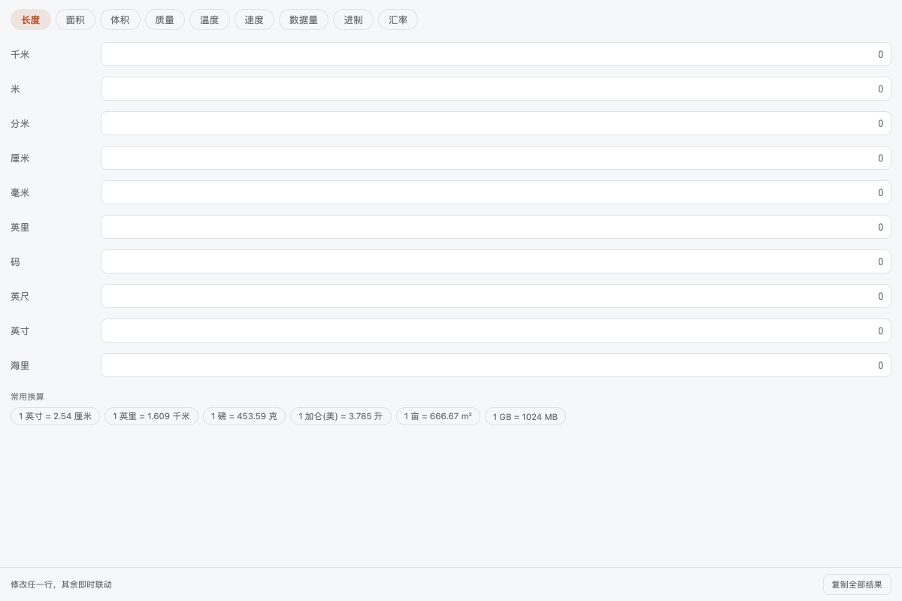

# 单位与汇率

长度/面积/体积/质量/温度/速度/数据量/进制/汇率同屏联动换算，人民币大写。

## 功能

- 单位与汇率换算

## 使用方式

在 eNest 中打开插件，或使用快捷启动搜索功能名称。主窗口适合连续操作，Quick 适合完成一次任务；可在两种模式之间切换。

## 数据与权限

本插件申请的敏感权限：`net.fetch`、`clipboard.write`。使用相应系统、网络或用户数据能力时，eNest 检查清单并请求用户授权；你可以在插件设置中改为允许、询问或拒绝。

插件自身的数据与密钥存储、壳内界面、插件设置、主题和声明式功能入口属于 eNest 的基础能力，直接可用，无需在清单中声明或单独授权。插件仍在隔离环境运行，不能直接访问 Node 或操作系统；读取、写入用户文件须经过宿主的文件选择与句柄 API。

## 界面预览

截图使用隔离演示数据，不连接用户的真实账户、服务器或文件。
