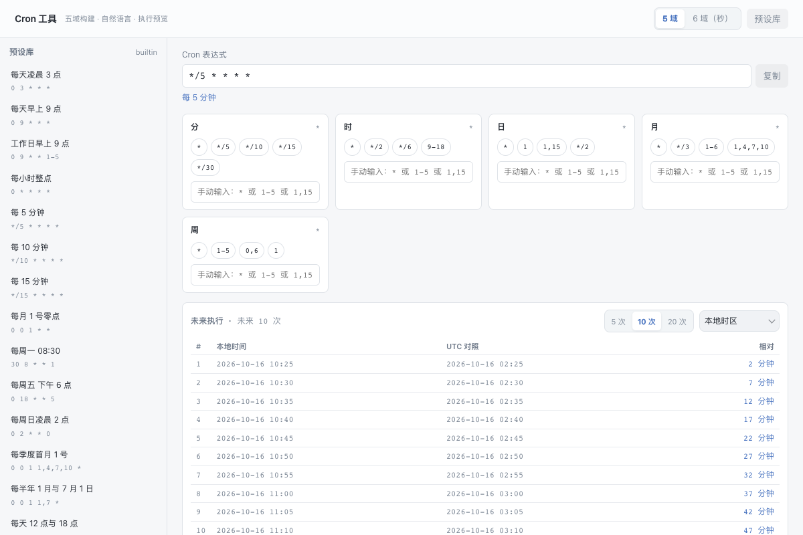

# Cron 工具

五/六域可视化构建、中文人性化描述、未来执行预览、预设库与 crontab 导出。

## 功能

- Cron 表达式构建与解析（5 域 / 6 域含秒）
- 中文人性化描述（"工作日早上 9 点"、"每天 12 点与 18 点"）
- 未来执行预览：5 / 10 / 20 次可调，绝对时间与相对时间双显示
- 预设库 16 条，可保存自定义；crontab 行粘贴解析与导出
- 错误精确到域定位；显式拒绝 Quartz 专有的 L / W / # / ? 语法

## 使用方式

在 eNest 中打开插件，或使用快捷启动搜索功能名称。主窗口适合连续操作，Quick 适合完成一次任务；可在两种模式之间切换。

## 界面预览

截图使用隔离演示数据，不连接用户的真实账户、服务器或文件。
