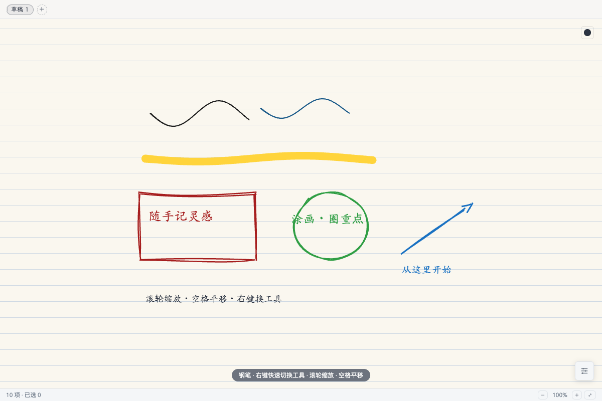

# 画板（drawboard）

像在 iPad 上随手涂画一样的自由画板：压感钢笔、荧光笔、手绘风图形与手写体文字、贴图标注，滚轮缩放、空格平移，多页草稿自动保存，一键复制与导出 PNG / JPG。内置 MCP 工具，AI 客户端可直接在画板上绘制草图并把画面截图看回来。

## 核心能力

- **手绘钢笔**：perfect-freehand 压感笔迹，按书写速度自然变细变粗；光标就是一支钢笔尖
- **荧光笔**：半透明宽笔头，标注重点不遮内容
- **手绘图形**：矩形 / 椭圆 / 直线 / 箭头，rough.js 手绘风抖动（设置里可调「规整 → 奔放」），Shift 约束正形与 45°
- **手写体文字**：内置霞鹜文楷 Lite（OFL 开源），中文文字与手绘图形风格统一；双击已有文字可再编辑
- **贴图**：按 I（或右键「插入」）选择本地图片、直接拖入，或 ⌘V 粘贴剪贴板图片，贴进画布可拖动缩放，在图上直接涂画
- **橡皮两种**：整笔橡皮划过删整条；局部橡皮只擦划过的一段（矢量切分，保留可撤销历史）
- **批量编辑**：选择工具（V）框选（完全圈住才选中）/ Shift 多选 / ⌘A 全选，空心图形点边框选中、重叠处连点循环换层，拖动、八向手柄缩放、方向键微移、⌘D 原位复制、Del 删除、右键置顶置底；画完图形自动进入选中可直接缩放
- **无限画布**：滚轮以光标为中心缩放，空格按住（或中键）拖拽平移，状态栏一键适配全部内容
- **右键菜单**：画布右键快速切换全部工具与复制 / 导出 / 清空；选中对象右键直接编辑
- **顶部草稿 Tab**：顶栏只保留草稿页切换，双击重命名、中键或 × 关闭、＋ 新建，自动保存到插件私有存储，重开恢复
- **右上角墨色浮标**：鼠标移到画布右上角自动展开色板，移开收起；「自动」恢复跟随主题墨色
- **复制与导出**：右键菜单复制画布为 PNG 到剪贴板；导出走系统保存对话框，PNG 白底 / PNG 透明底 / JPG 三档

## 主题

插件内右下角浮动按钮打开设置：草稿纸 / 深色 / 米黄纸 / 黑板四套纸感主题，手绘粗糙度滑杆，纸面纹理（横线 / 方格 / 点阵 / 无）。默认草稿纸是暖白纸面配淡横线，草稿 Tab 使用内置手写体。设置仅保存在本插件内。

## AI 绘制（eNest MCP）

在宿主设置「开发者 → MCP 服务」启用服务并复制连接配置给 AI 客户端后，画板提供以下 MCP 工具，AI 无需打开画板窗口即可作画（调用时静默冷启动隐藏页）：

- `capture`：把草稿渲染成 PNG/JPEG 图像回传，AI 能"看见"画布内容
- `elements.add / update / delete`：批量绘制钢笔墨迹、手绘图形、文字、橡皮笔迹与贴图（base64 图片）
- `draft.list / get / create / rename / switch / clear`：多页草稿管理，读取结构化对象 JSON
- `history.undo / redo`：与手动编辑共享活动草稿的撤销栈

默认画在当前活动草稿上（用户正在看的那页）；AI 也可以带 `draftId` 直接写入其它草稿。工具细节遵循 eNest 官方 MCP 贡献标准（开发者文档 mcp.md）。

## 快捷键

| 按键 | 动作 |
| --- | --- |
| V / P / H / E / ⇧E | 选择 / 钢笔 / 荧光笔 / 整笔橡皮 / 局部橡皮 |
| R / O / L / A / T / I | 矩形 / 椭圆 / 直线 / 箭头 / 文字 / 贴图 |
| 滚轮 | 以光标为中心缩放 |
| 空格拖拽 / 中键拖拽 | 平移画布 |
| ⌘Z / ⌘⇧Z | 撤销 / 重做 |
| ⌘C / ⌘V / ⌘D | 复制对象 / 粘贴（或粘贴剪贴板图片为贴图）/ 原位复制 |
| ⌘A / Del / Esc | 全选 / 删除 / 取消选择 |
| 方向键（+⇧） | 微移 2px（大步 10px） |

## 权限说明

- `clipboard.writeImage`：仅用于「复制画布 PNG」写剪贴板图片，需要你授权
- 草稿与设置保存在插件私有存储；导出图片通过系统保存对话框由你选定位置

## 许可

字体：[霞鹜文楷 Lite](https://github.com/lxgw/LxgwWenKai-Lite)，SIL Open Font License 1.1。
