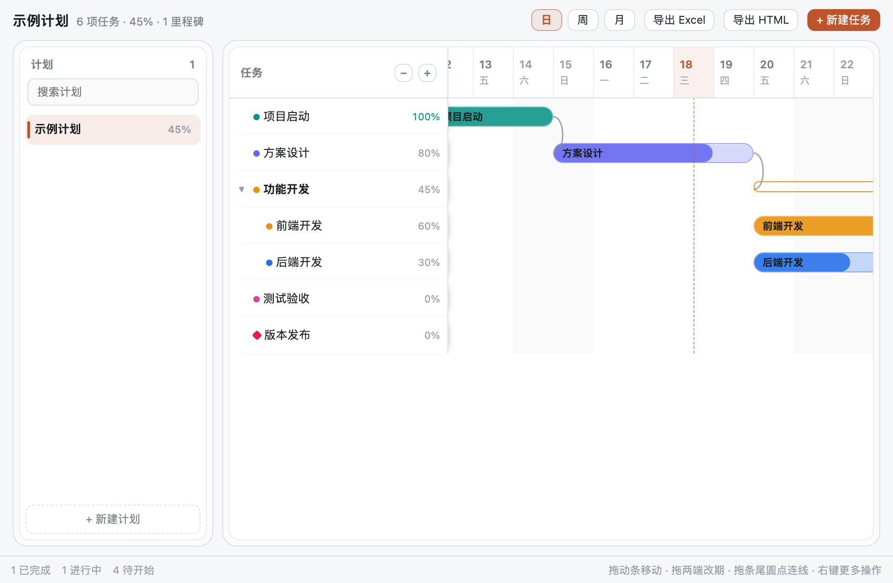

# 甘特图

项目计划甘特图：多计划管理、任务时间范围拖拽调整、进度、依赖连线、子任务与里程碑。

## 功能

- 多计划管理，左侧计划列表快速切换
- 任务条拖拽移动与改期（日 / 周 / 月三种粒度，吸附对齐）
- 进度百分比填充，依赖连线（完成-开始），子任务层级汇总，里程碑菱形标记
- 右键菜单：编辑、复制、删除、进度快捷档、换色、设为里程碑、清除依赖等
- 导出 Excel（.xlsx，任务色填充）与自包含 HTML
- MCP 工具：计划与任务的完整读写与计划摘要

## 使用方式

在 eNest 中打开插件，或使用快捷启动搜索「甘特图 / gantt / 排期」。左栏选择计划，顶栏切换时间粒度并新建任务；拖动任务条整体移动，拖动两端手柄改期，从条尾圆点拖出依赖连线。

## 界面预览

截图使用隔离演示数据，不连接用户的真实账户、服务器或文件。
