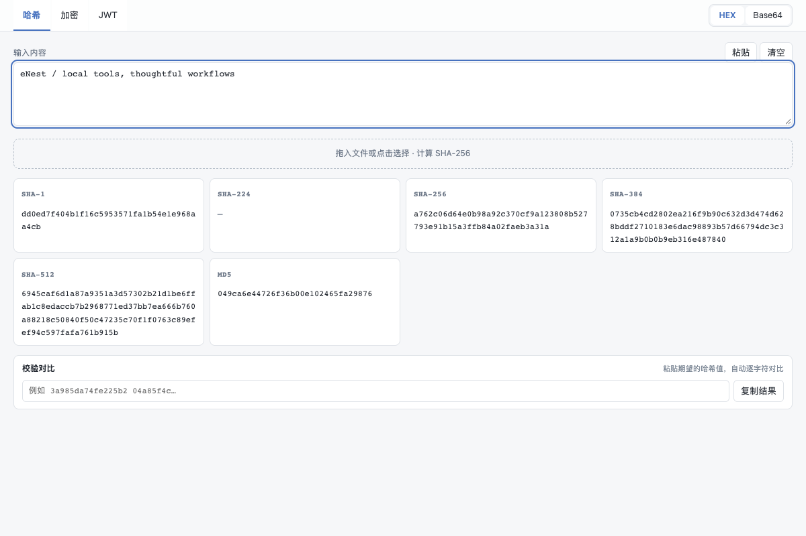

# 哈希与加密

多算法同屏哈希（SHA 家族/MD5）、HMAC、AES-GCM 与 RSA 加解密签名、JWT 解码、hex/base64 输出。

## 功能

- 哈希 / 加解密 / JWT 解码

## 使用方式

在 eNest 中打开插件，或使用快捷启动搜索功能名称。主窗口适合连续操作，Quick 适合完成一次任务；可在两种模式之间切换。

## 界面预览

截图使用隔离演示数据，不连接用户的真实账户、服务器或文件。
