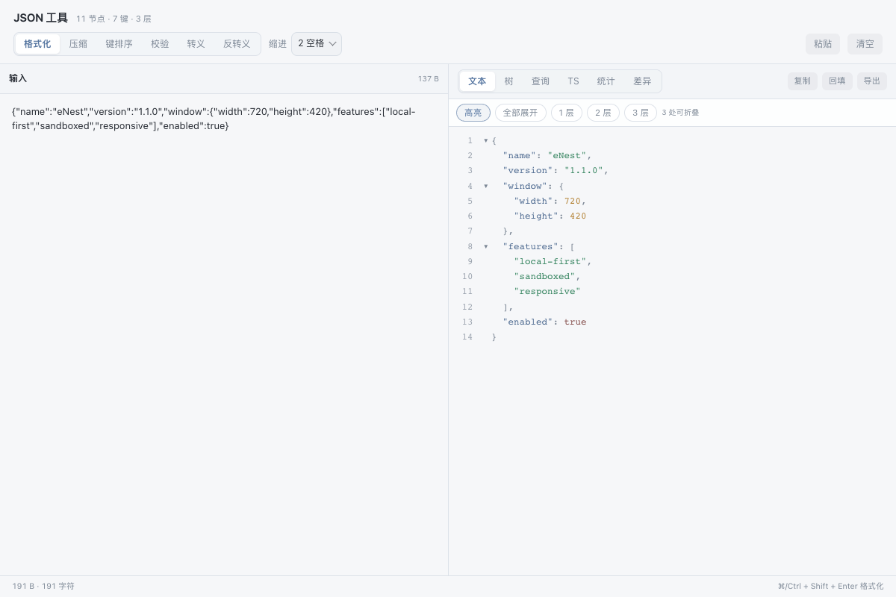

# JSON 工具

无损数字 JSON 格式化、路径查询、TypeScript 类型生成、统计、树浏览与差异比较。

## 功能

- 格式化 / 压缩 / 键排序 / 校验（错误行列定位）/ 转义与反转义
- 路径查询（`.a.b`、`[*]`、`[0]`、`..name`）与结果提取
- TypeScript interface 生成（结构去重、数组联合类型）
- 统计面板（节点 / 深度 / 体积 / 键 Top 8 / 类型分布）
- 树浏览与搜索、双份 JSON 差异比较

## 使用方式

在 eNest 中打开插件，或使用快捷启动搜索功能名称。主窗口适合连续操作，Quick 适合完成一次任务；可在两种模式之间切换。

## 界面预览

截图使用隔离演示数据，不连接用户的真实账户、服务器或文件。
