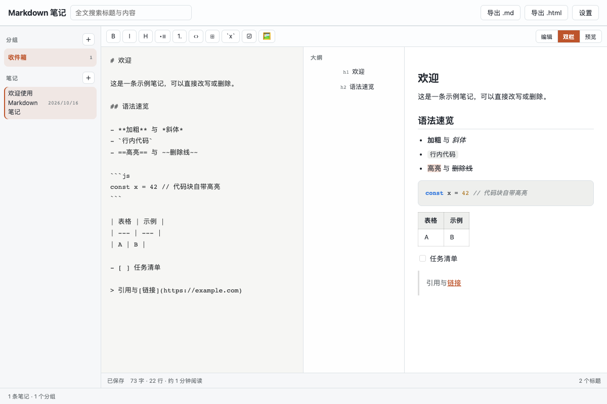

# Markdown 编辑器

Typora 式所见即所得 Markdown 编辑器：本地文件工作台、即时渲染、Typora 主题、手绘风 Mermaid 与多通道图床上传。

## 功能

- 所见即所得编辑：未聚焦段落即时渲染，点击进入源码（Typora 手感）
- 本地文件：打开 / 拖入 .md、⌘S 静默保存（无弹框）、外部修改监听与冲突处理、目录树多根切换
- Typora 主题兼容：导入 Typora 社区主题 CSS 直接生效；内置 eNest Minimal（浅 / 深）
- Mermaid 图：默认手绘风（Excalidraw 感），可选圆润 / 经典
- 数学公式（KaTeX）、脚注、任务清单、表格、front matter、HTML 渲染开关（消毒后生效）
- 图床上传：本地 assets 目录 / PicList / GitHub 仓库 / 自定义 JS 脚本（沙箱）
- 粘贴图片：上传、存本地、转 base64 三选一（可设默认动作）
- 打字机模式（F8）/ 专注模式（F9）、可折叠大纲、图片资产面板（外链转本地）
- 导出：HTML 单文件 / PDF（系统打印）/ PNG 长图
- Quick 速记：全局呼出，一行落收件箱，⌘⏎ 转主窗继续编辑

## 权限说明

- `backend.node`：本地文件读写与监听、图床上传、自定义脚本沙箱（插件自带 Node 后端）
- `clipboard.readImage` / `clipboard.write`：粘贴图片上传、复制图片链接
- `shell.openExternal`：打开文内链接与图床管理页

## 使用方式

在 eNest 中打开插件；首次使用请在授权对话框允许后端能力。图床、主题、脚本在「设置」页配置（工具栏 ⚙）。粘贴截图即触发图片菜单；把 Typora 主题 CSS 粘贴到设置 → 主题即可导入。

## 界面预览

截图使用隔离演示数据，不连接用户的真实账户、服务器或文件。
