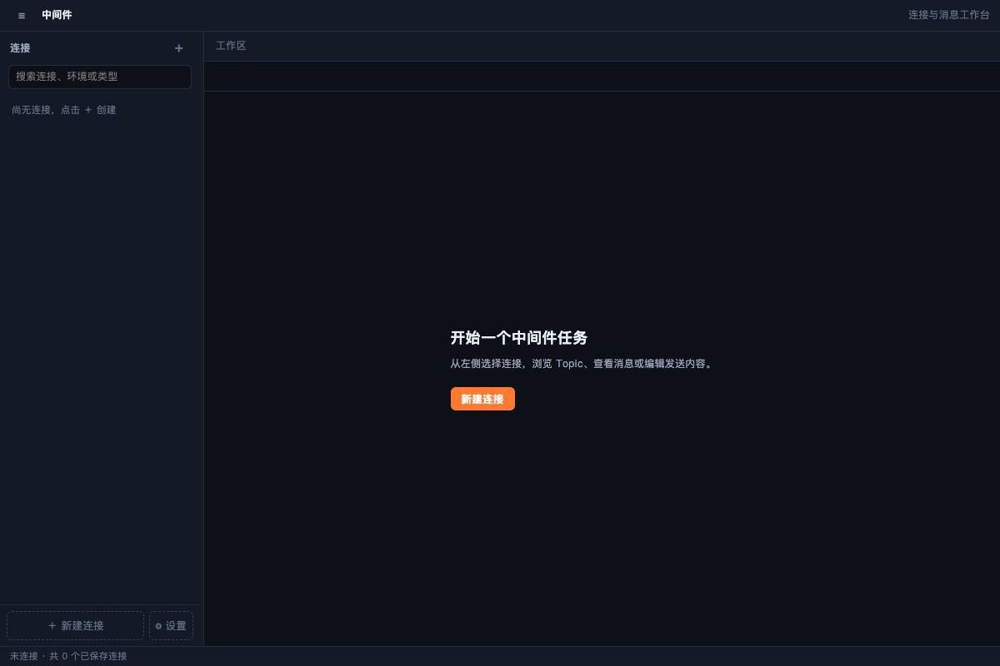

# 中间件控制台

Kafka / RabbitMQ / MQTT / RocketMQ 统一控制台：连接管理、Topic 与队列、消息查询溯源与实时监听、消费组与监控

## 功能

- 消息中间件控制台

## 使用方式

在 eNest 中打开插件，或使用快捷启动搜索功能名称。主窗口适合连续操作，Quick 适合完成一次任务；可在两种模式之间切换。

## 0.4.0 升级说明

本版要求 eNest >=0.2.2。连接、消息协议、监听和工作台逻辑全部位于插件自己的 Node 后端，壳不再提供 `enest.mw` 业务 API。需明确授权 `backend.node`；`mw.connect` / `mw.query` / `mw.admin` 是插件解释的操作授权，不能替代本机 Node 完整信任，也不构成系统沙箱。

原连接与 vault 引用继续使用；主连接密码和 EMQX 管理密码只在插件后端解引用。关闭连接/插件会释放监听和常驻会话；新迁移专项使用 mock，并非真实集群认证或连接验收。

## 界面预览

截图使用隔离演示数据，不连接用户的真实账户、服务器或文件。
