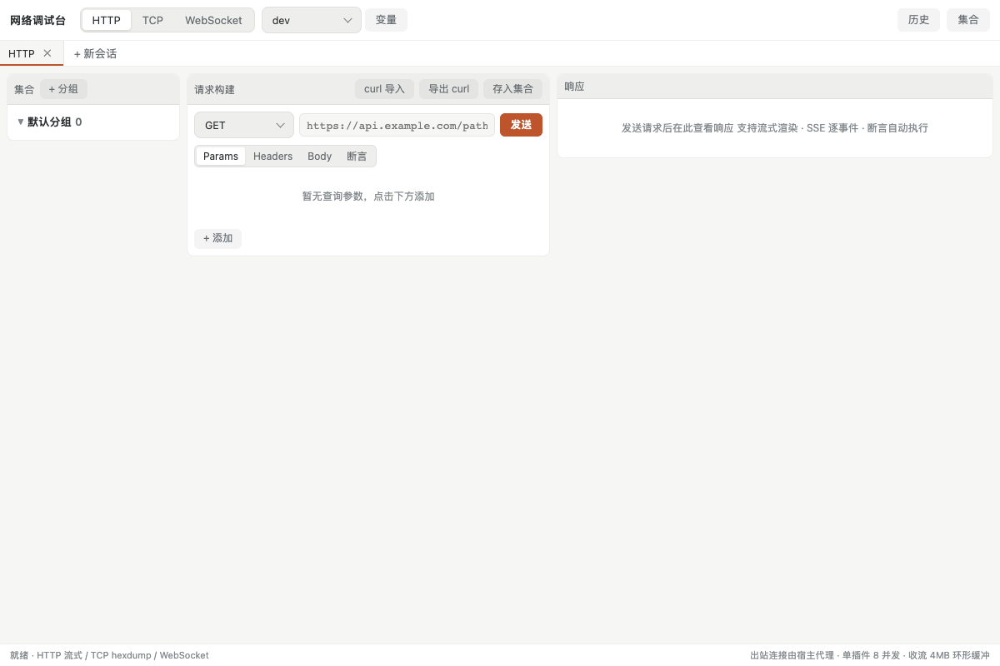

# 网络调试台

HTTP / TCP / WebSocket 调试工作台：流式响应与 SSE、十六进制字节流、编解码策略、断言、curl 导入导出、集合与历史

## 功能

- 网络调试台：HTTP / TCP / WebSocket

## 使用方式

在 eNest 中打开插件，或使用快捷启动搜索功能名称。主窗口适合连续操作，Quick 适合完成一次任务；可在两种模式之间切换。

## 界面预览

截图使用隔离演示数据，不连接用户的真实账户、服务器或文件。
