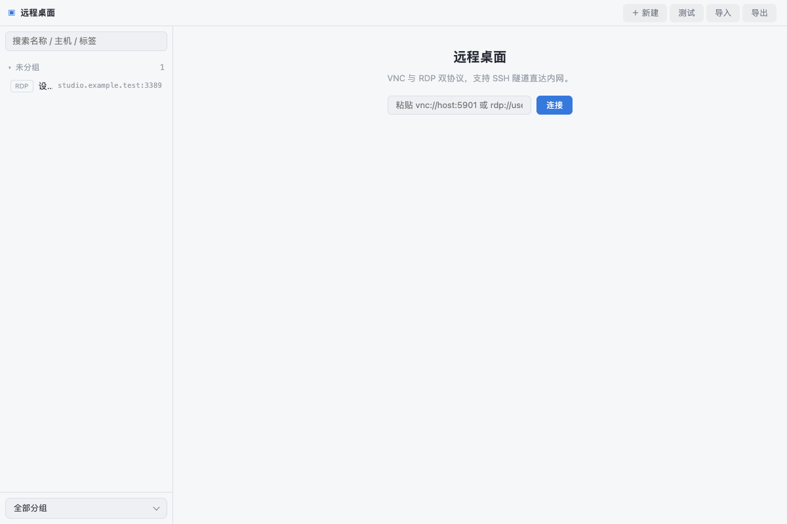

# 远程桌面（com.github.eNest.remote-desktop）

VNC / RDP 双协议远程桌面插件。Quick 单会话沉浸，Shell 多会话工作台。

## 功能

- **资产管理**：主机 / 端口 / 协议（VNC·RDP）/ 凭据 / 分组 / 标签 / 只读开关；密码经壳子 vault 加密保存（secretRef，无明文回读；编辑留空 = 不修改）
- **SSH 隧道**：资产启用隧道后先经 `enest.ssh.workbench tunnel.open` 打洞，再走本地桥（内网机器可达）
- **VNC**：vendored noVNC 1.5.0；ZRLE / Tight / Hextile 协商、指针形状、剪贴板文本双向、画质档、只读
- **RDP**：vendored ironrdp-wasm（wasm-pack web 构建）；经壳子 socketBridge rdp 模式完成 RDCleanPath + TLS 终止；mac Cmd 映射远端 Ctrl
- **诊断**：连接测试 = TCP 探活 + 协议握手首包（VNC 读 RFB 版本串 / RDP 走桥握手），给出可读失败原因
- **体验**：最近连接（时间+时长）、缩放三档（适应/1:1/拉伸）、会话信息浮层（帧率/延迟/编码/分辨率）、截图保存与贴图、断线自动重连（指数退避、不清屏）、会话期防休眠、关闭前优雅断开

## 快速上手

1. 粘贴 `vnc://host:5901` 或 `rdp://user@host:3389` 直接连；或「新建」建资产
2. 内网机器：编辑资产勾选「经 SSH 隧道」（需先在 SSH 插件建立会话）
3. 「测试」验证可达性与协议诊断

## 依赖

- 壳子 ≥ 0.1.0（需要 `net.socket.serveWs` 的 rdp 模式支持 RDP）

## 第三方

noVNC（MPL-2.0/BSD）、pako（MIT）、ironrdp-wasm（MIT）、rdp-proxy 协议参考 electerm/ironrdp-wasm example（MIT）。详见 CHANGELOG.md 与 `assets/vendor/*/LICENSE*`。

## 界面预览

截图使用隔离演示数据，不连接用户真实账户。

### 本机后端

SSH 协议驱动随插件发布，在独立 Node 后端进程中运行。首次使用需要授权 `backend.node`；这允许插件后端执行完整 Node.js 代码，不是受限沙箱。SSH 会话、隧道和传输随当前插件实例关闭而回收。现有文件操作仍通过宿主选择器生成的文件句柄，私钥和密码分别经文件句柄和私有密钥库使用。
