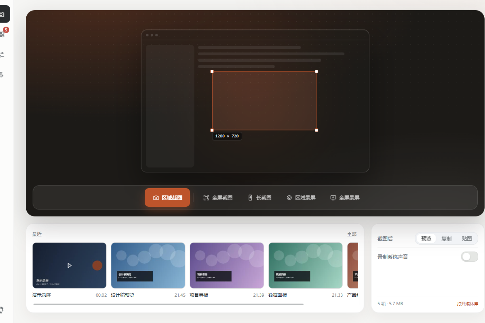

# 屏幕助手

截图、长截图、区域/全屏录屏、统一媒体库、标注、GIF、贴图与图片工具，集中在一个插件里。

## 功能

- 区域截图：在实时桌面上拖动、移动或调整选框；按 Enter、双击选区或点「截图」才截取当时的画面。Esc 取消，不截取也不保存。全屏截图则直接截取所选显示器一次。
- 截图后可标注、预览、复制或贴图。「标注」和「预览」在可移动的独立窗口里打开，不会用静态图片覆盖桌面。标注完成后另存并复制，取消仍保留原图。滚动长截图在确认范围、点击「开始」后采集画面，不采集声音。
- 录屏：可录选区或全屏，支持开始、暂停、继续、停止和取消。只有录屏提供「录制系统声音」，默认关闭；开启但系统没有提供音轨时会提示，不会自动改录无声视频。选区边框画在范围外，全屏录制不画边框；控制条能否从全屏录像中隐藏取决于系统的窗口捕获保护。
- 媒体库：截图与录屏统一缩略卡片、按日期浏览、搜索；放大查看、缩放平移、左右切换、删除、导出、贴图、编辑。
- 截图编辑：箭头、矩形、文字、马赛克、裁剪；撤销重做；原图永不覆盖，另存为新条目。
- 录屏处理：WebM 直录；GIF 导出（帧率、宽度、起止范围、倍速）、截取当前帧。
- 图片工具：压缩、格式转换、缩放、旋转翻转裁剪、文字水印、EXIF、色板。
- 贴图：截图并贴、剪贴板图片、本地图片。

## 使用方式

在 eNest 小窗口输入 `jt` 可直接框选截图，或搜索「全屏截图 / 长截图 / 录屏 / 贴图 / 图片」。打开插件时，「截图」提供区域、全屏和长截图；切到「录屏」可选区域或全屏。当前模式的按钮等宽横排，最近项目占用下方剩余空间。点击「媒体库」或在顶部搜索框输入名称可查找历史，点击「返回拍摄」即可回来。

## 界面预览

界面截图使用隔离演示数据，不连接用户的真实账户、服务器或文件。
