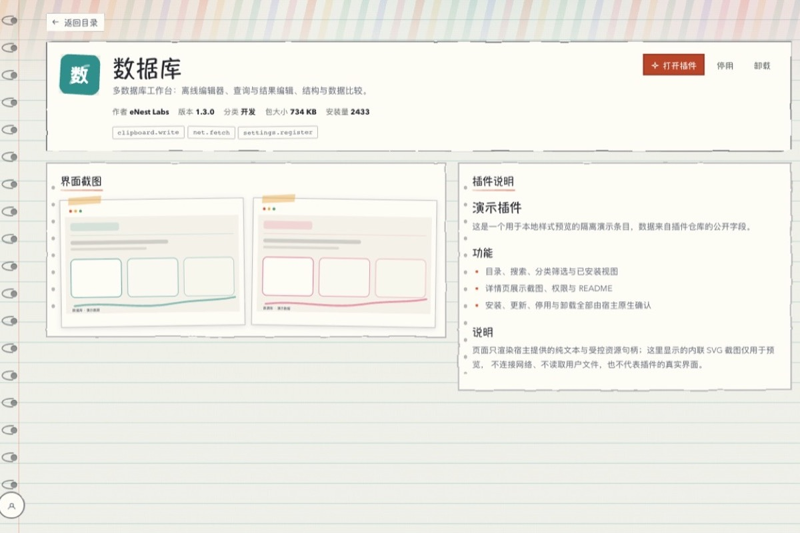
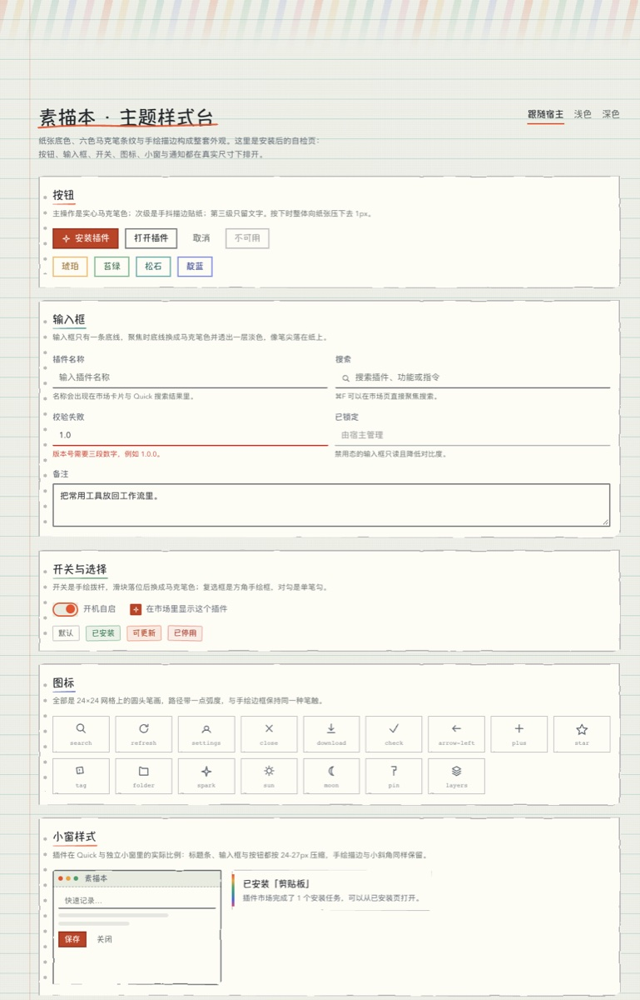

# 素描本

桌面上的纸品主题：索引卡、方格纸、牛皮纸、相纸与便签各有自己的纸色、纹理和投影高度，手工抖动的描边、胶带与折角；首页按 4 列 × 7 行的不规则拼贴陈列，每张纸的尺寸由内容决定。浅色是灰绿桌配暖白纸，深色是夜里开灯的木桌。

## 包含内容

- 主题包 `com.github.eNest.sketchbook / sketchbook`：浅深两套语义色、五级纸品、手写字体栈、三级手抖描边滤镜与分级投影。纸是直角物件，圆角只用于控件。
- **不规则拼贴首页**：六张纸一组（1×4 竖长条 / 1×2 小方纸 / 2×3 竖大纸 / 2×4 横幅大纸），面积正好铺满 4 列 × 7 行，不出现"两列宽的空白"；余数由 `dense` 回填。每张纸必须被填满：贴真实截图、手绘速写页、标签与铅笔批注三选一。
- **手绘动效**：线条沸腾（三个不同种子的位移滤镜按 3 帧轮换，模仿真人反复描线）、纸片掀起（悬停时纸角翻起、投影散开）、胶带压实。
- 配套市场工作区：目录与详情两条宿主路由，"已安装"是插件本地目录筛选。详情以活页纸弹框覆盖当前列表，关闭后保留筛选、滚动位置、分类与搜索；支持 Escape、遮罩关闭与键盘焦点恢复。
- **自绘设置页**（`settingsPage`）：左侧书签条 + 右侧方格活页纸；整组颜色字段切成色卡网格，带缩略图的选项渲染成纸样卡。只使用宿主发布的字段句柄，原生安全入口始终保留。
- 低负载漂移：不透明原生页面自行绘制桌面织物纹与漂移，不依赖壳层透出。没有逐帧脚本、Canvas 或大面积动态模糊。
- 动画分档：高档全部纸片沸腾，中档只给主推大纸；低档、系统「减少动态效果」或宿主禁用持续动画时全部静止但保留静态纸面。后台页面及隐藏预热时暂停。
- 宿主真实开屏：默认使用通用「纸页描线」预设，品牌、主题底色和自定义图片仍可选。首页首次可见只做轻量内容进场。
- 主题样式台：同一套纸面语言下的按钮、输入框、开关、图标、小窗与通知样张；浅色 / 深色为本地预览，「跟随宿主」恢复最近的外观快照。

## 使用方式

1. 安装本插件，在宿主「设置 → 主题」中选择「素描本」。
2. 选中后设置界面切换为素描本自绘的设置页，分五组：**纸与墨**（桌面、纸张、墨色与马克笔共 13 项色卡）、**纸面与桌面**（桌面纸色、壳层光效、漂移速度、纸纹颗粒、开屏）、**手写与字号**、**纸面陈列**（内容宽度、纸边距、纸片间距、列数、动效）、**纸边与通知**。
3. 三套桌面纸色沿用原来的稳定 ID（灰绿桌 / 雾蓝桌 / 砂褐桌），已有选择可直接使用更新后的配色。
4. 「壳层光效」默认关闭，只影响壳层，不控制插件页面自己的桌面漂移；停用漂移请使用「静止」动效档或系统减少动态效果。
5. 全局设置入口、顶部标签栏与圆轨由宿主统一管理；设置页里的「可信原生设置」入口随时可以回到宿主的系统、账号与安全设置。

## 界面预览

下列截图保留了较早的手绘拼贴布局示意，尚未重拍不规则的纸品拼贴版式与自绘设置页。当前配色与版面以主题首页和设置页的实际渲染为准。

截图使用隔离演示数据，不连接用户的真实账户、服务器或文件。
