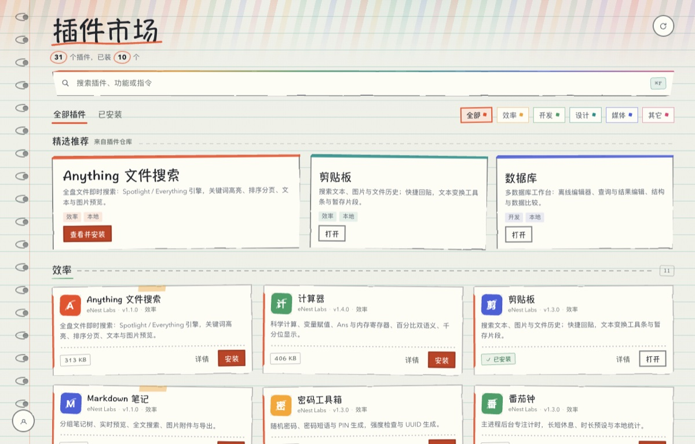
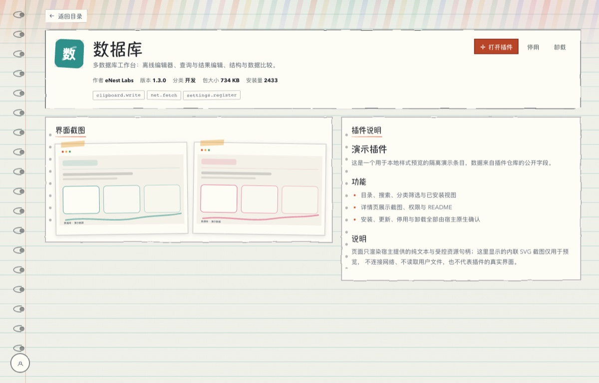
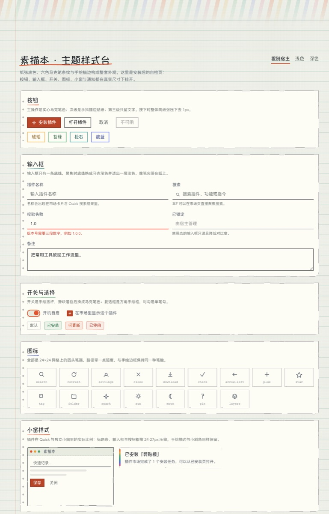
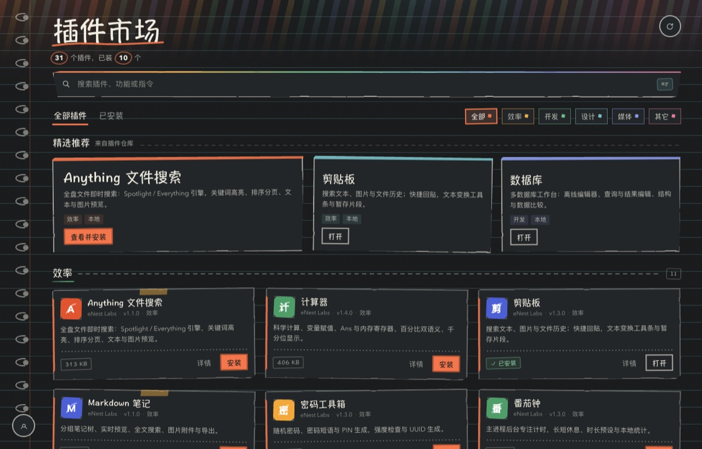

# 素描本

保留手写标题、SVG 抖动描边、胶带与螺旋装订的纸面主题。背景改为纸灰、灰蓝、鼠尾草三套低饱和色板，分别适配浅色与深色；六色彩墨只留在页边、下划线和分类标记上，不再铺满鲜亮的黄、粉或紫色。

## 包含内容

- 主题包 `com.github.eNest.sketchbook / sketchbook`：浅深语义色、真实手写字体栈、SVG 手抖描边、斜切卡纸与胶带拼贴。圆角、描边和通知外观仍使用主题 schema。
- 配套市场工作区：目录与详情两条宿主路由，“已安装”是插件本地目录筛选，共用同一整页纸面背景。详情以活页纸弹框覆盖当前列表，关闭后保留已安装筛选、目录滚动位置、分类与搜索；支持 Escape、遮罩关闭和键盘焦点恢复。
- 装订环固定在可视区左侧，不随内容滚走；底部给宿主全局设置按钮留出空间。
- 精选推荐采用主推荐与两张索引便签拼贴，展示真实插件截图或图标。中档已有翻卡入场及悬停反馈，高档增强，低档与减少动态效果降级。
- 低负载漂移：不透明原生页面自行绘制背景，不依赖壳层透出。两张静态纸面渐变只做 transform / opacity 漂移，没有逐帧脚本、Canvas 或大面积动态模糊。
- 动画分档：中档持续轻柔漂移，高档略增位移；低档、系统「减少动态效果」或宿主禁用持续动画时保留静态纸面。后台页面及隐藏预热时暂停，卸载时清理订阅与资源。
- 宿主真实开屏：默认使用通用「纸页描线」预设，品牌、主题底色和自定义图片仍可选。首页首次可见只做轻量内容进场，不再播放第二次全屏开屏。需要包含该预设的新宿主构建。
- 主题样式台：使用同一背景与色板，可预览按钮、输入框、开关、图标、小窗和通知；浅色 / 深色为本地预览，「跟随宿主」恢复最近的外观快照。
- 所有滚动区域使用主题语义色的细圆滚动条，详情和长文本留出滚动条与内容之间的间距。

## 使用方式

1. 安装本插件，在宿主「设置 → 主题」中选择「素描本」。
2. 在主题参数中调整纸面色板、铺色、描边、圆角、字号比例、内容布局和动画强度。三套色板沿用原来的稳定 ID，已有色板选择可直接使用更新后的柔和配色。
3. 「宿主额外光效」默认关闭，只影响壳层，不控制主题页面自己的纸面漂移；停用漂移请使用低动画档或系统减少动态效果。
4. 全局设置入口、顶部标签栏和左侧圆轨由宿主统一管理，本主题不提供替代设置 dock，也不单独覆盖这些全局设置。

## 界面预览

下列截图保留了 1.0.0 的手写拼贴布局示意，尚未重拍 1.0.1 的柔和色板。当前配色以主题参数的动态色卡及主题样式台为准。

截图使用隔离演示数据，不连接用户的真实账户、服务器或文件。
