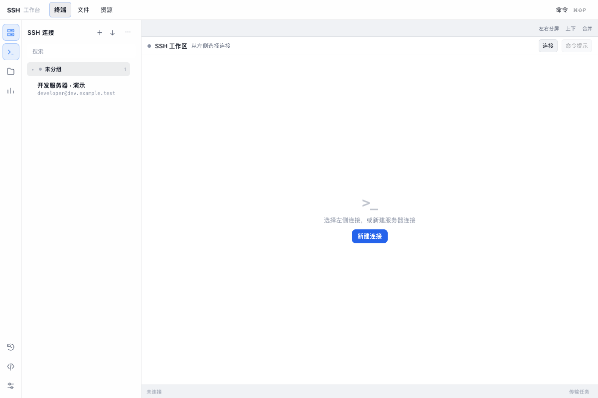

# SSH管理

SSH 工作台：快速连接、终端提示、远程文件、三平台资源与进程端口、服务容器、传输和隧道

## 功能

- SSH 管理与远程终端

## 使用方式

在 eNest 中打开插件，或使用快捷启动搜索功能名称。主窗口适合连续操作，Quick 适合完成一次任务；可在两种模式之间切换。

## 界面预览

截图使用隔离演示数据，不连接用户的真实账户、服务器或文件。

### 本机后端

SSH 协议驱动随插件发布，在独立 Node 后端进程中运行。首次使用需要授权 `backend.node`；这允许插件后端执行完整 Node.js 代码，不是受限沙箱。SSH 会话、隧道和传输随当前插件实例关闭而回收。现有文件操作仍通过宿主选择器生成的文件句柄，私钥和密码分别经文件句柄和私有密钥库使用。
