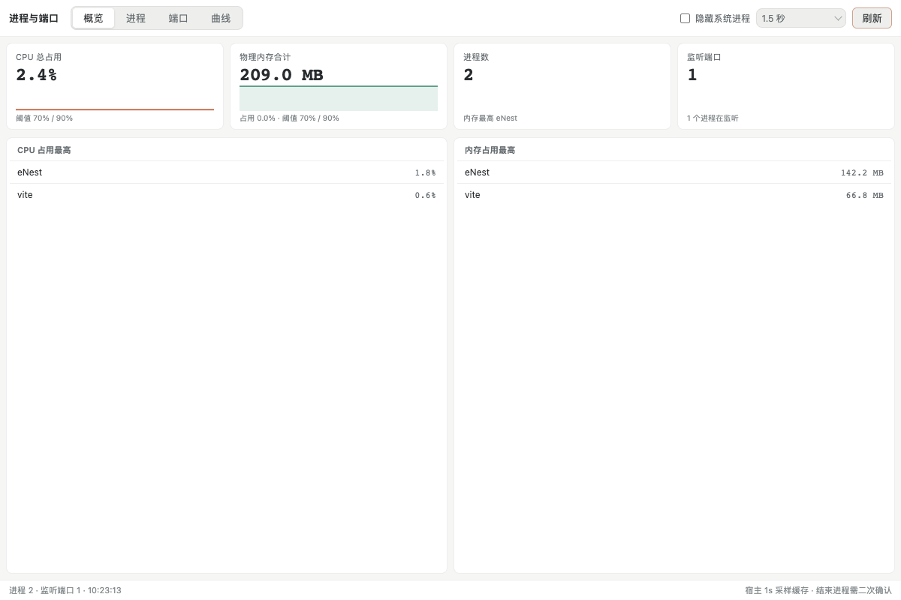

# 进程与端口

本机进程与监听端口巡检：双表联动、搜索、收藏置顶、结束进程危险确认、CPU·内存 60 秒滚动曲线

## 功能

- 小窗默认显示全部进程；在宿主输入框输入进程名、PID 或端口号即可筛选。
- 整机 CPU 趋势和进程内存趋势分别绘制，结束进程仍需确认。

## 使用方式

在 eNest 中打开插件，或使用快捷启动搜索功能名称。主窗口适合连续操作，Quick 适合完成一次任务；可在两种模式之间切换。

## 界面预览

截图使用隔离演示数据，不连接用户的真实账户、服务器或文件。
