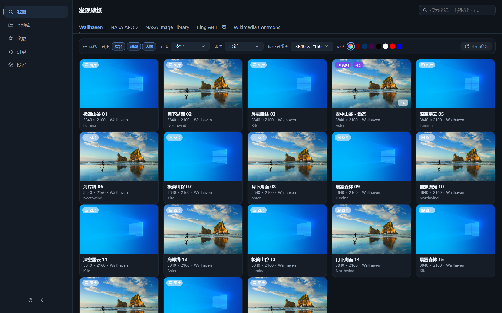
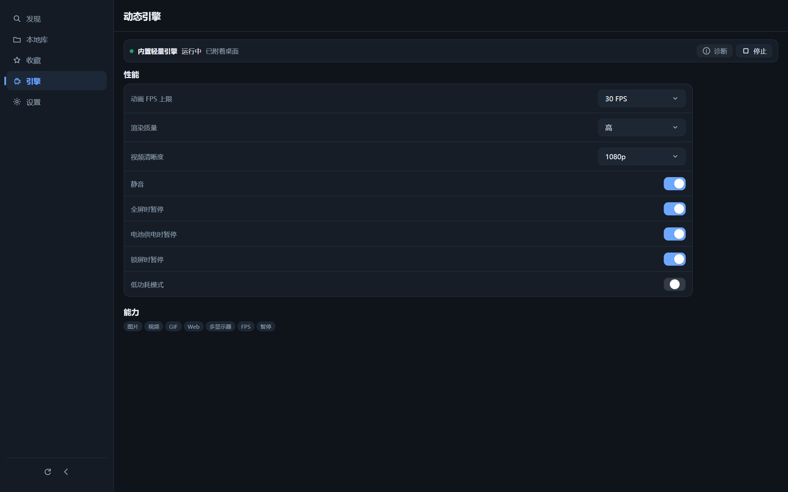
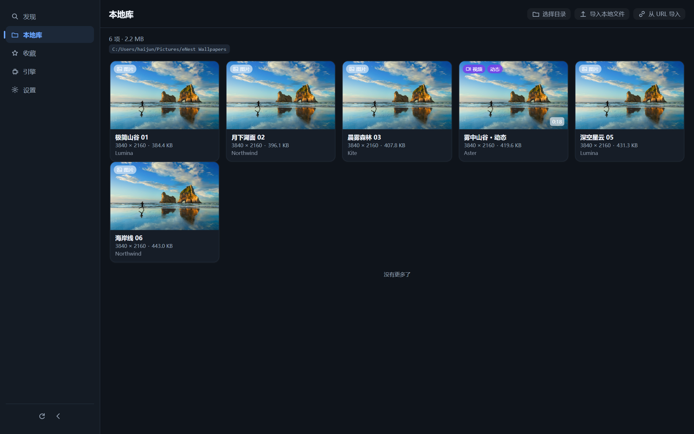
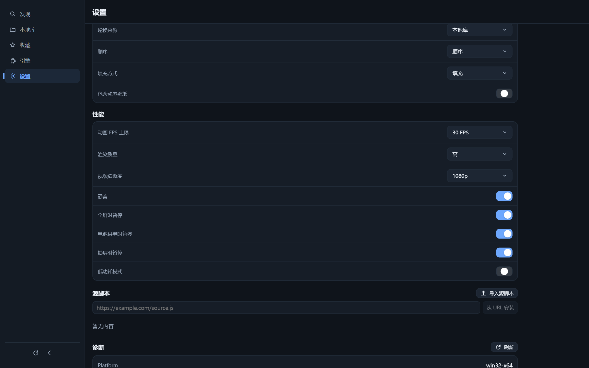

# 壁纸屋

多源壁纸聚合与本地库管理：发现静态/动态壁纸，下载到自己的目录，设置系统壁纸，并用自研内置引擎播放视频、GIF 与 Web 壁纸。

## 功能

- 内置 15 个数据源适配器：Wallhaven、NASA APOD、NASA Image Library、NASA Videos、Bing 每日一图、Lorem Picsum、Wikimedia Commons、Openverse、芝加哥艺术博物馆、大都会艺术博物馆、Unsplash、Pexels（照片/视频）、Pixabay（照片/视频）、GIPHY、Alpha Coders。
- 免 Key 源开箱可用；需要 Key 的源在设置中保存到宿主密钥库，不写入普通设置或日志。
- 动态过滤：来源自己声明 facets（分类、纯度、排序、分辨率、比例、颜色、标签等），界面按能力动态生成控件。
- 本地库：用户选择目录，原子写入、SHA-256 去重、缩略图缓存、收藏、删除确认；库索引、收藏、轮换和设置通过宿主 KV 持久化。
- 静态壁纸：Windows 使用 IDesktopWallpaper（逐屏与填充方式）；macOS 使用 NSWorkspace；Linux 按 GNOME/KDE/XFCE/X11/wlroots 适配。
- 动态壁纸：只使用插件自研的内置轻量引擎（WebView2/WKWebView/WebKitGTK），不读取或安装第三方壁纸引擎。
- 视频性能：下载时可选原画 / 1080p / 720p（Pexels、Pixabay 等多码率源），播放走本机回环 Range 服务；WebView 开启 GPU 光栅与硬件视频解码，支持动画 FPS 上限、渲染质量、静音、全屏/电池/锁屏暂停与低功耗模式（24 FPS 且渲染缩放不超过 0.9）。
- 自动轮换：本地库或收藏，顺序/随机，可包含动态壁纸；只在 eNest 运行期间生效。
- 源脚本：可导入用户信任的 JS 源脚本，扩展更多站点；默认不内置抓取站脚本。

## 平台与限制

- 动态壁纸只在 **eNest 运行期间** 播放；退出 eNest 会停止内置 helper，不会写开机自启或系统计划任务。
- 内置引擎覆盖 Windows（WorkerW + WebView2）、macOS（桌面层 WKWebView）、Linux X11 与 wlroots（sway/Hyprland，GTK/WebKitGTK）。GNOME/KDE Wayland 不开放任意桌面层，请使用静态壁纸。
- 不支持第三方专有场景包、Steam Workshop 下载、锁屏壁纸、逐屏不同动态内容。
- Bing 每日图仅限个人桌面使用，插件不提供导出/再分发；Pixabay 内容会本地缓存并标注来源。
- 内置 helper 需要随平台构建；源码构建默认不包含二进制，缺失时引擎页会显示原因。

## 权限

- `backend.node`：运行插件后端，执行本机壁纸命令、下载与动态 helper。首次调用时由宿主原生授权框确认；后台常驻前请选择“允许并记住”。
- `shell.openExternal`：仅在用户点击来源/许可链接时打开浏览器。

## 隐私

不收集遥测。API Key 只保存在 eNest 密钥库；下载与本地库都在用户选择的目录中。源脚本由用户自行安装，属于用户信任代码。

## 许可

插件代码随 eNest 插件仓发布。各壁纸来源的许可、署名要求以条目的 `license`/`attribution` 字段为准。
